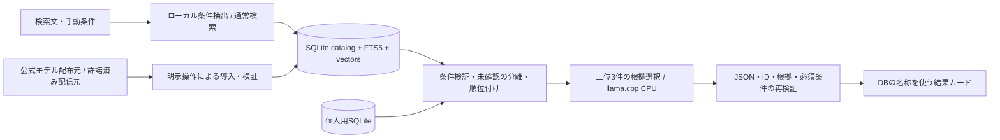

# 構成と境界

## 保存

`%LOCALAPPDATA%\WorldCompass\` の `models/ runtime/ catalog/ userdata/ logs/ staging/`。試験時のみ `WORLD_COMPASS_DATA_DIR` で専用保存先を指定可能。個人SQLiteとカタログSQLiteは別ファイル。カタログの更新・削除は個人記録を削除しない。ユーザーデータはアンインストーラーで自動削除しない。

スキーマ版は1。未知の版は拒否。カタログ導入は検証後にSQLite savepointで原子的に置換。差分はbaseVersion一致、upsertとdeletedIdsを検証して適用。全文検索はSQLite FTS5 trigram、3文字未満や日本語自然文は条件抽出・属性と通常の文字列一致で補う。意味検索はローカル埋め込みとcosine。埋め込みキャッシュはカタログ更新で無効化。大規模カタログ用ANNは未実装。

## LLM

外向きネットワーク・ファイル・シェル・DB更新のツールを渡さない。llama-serverを127.0.0.1の一時ポートに限定し、起動毎のUUID API keyで認証。HTTPプロキシを無効にし、リダイレクトも禁止する。2 CPUスレッド、GPU層0、並列1、コンテキスト4096。チャットと埋め込みを同時に保持しない。モデル切替時・キャンセル・60秒のアイドル後・アプリ終了時に停止。Windows Job Objectでアプリ異常終了時も子を終了する。

上位候補はDBから取得する。LLMは根拠フィールドとsourceIdを選択し、自由文・名称・URLは生成しない。選択結果をネイティブ側とTypeScriptで再検証し、確認済み値から日本語文を構築する。これにより「軽い」「雨音」等の未確認事項の断定を防ぐ。ワールド説明文の命令を実行しない。モデル障害・起動失敗・タイムアウト・不正JSON・不正根拠は通常検索に戻す。

## 導入・通信

ネットワークから実行時manifestを受け取らない。固定の配布元・版・サイズ・ハッシュ・ライセンスをアプリに同梱し、改ざんされた外部manifestによる配布元変更を受け入れない。HTTPSのpartial downloadを保存し、Range/Content-Rangeを確認して再開。サイズ上限・空き容量・SHA-256・ZIP path traversal・symlinkを確認し、専用ステージから検証済み版へ切替。同版の修復時も旧ディレクトリを退避する。ランタイムZIPを保管して、起動時には同梱ハッシュでZIP自体と展開済みファイルを照合する。

カタログHTTPS同期の受け口はあるが、配信元は未設定。現版は架空JSONの導入に対応する。モデル・カタログの変更は新しい信頼済みアプリのmanifest更新が必要。旧版資産は版毎のフォルダに残るが、モデル版のUIからのロールバック選択は未実装。オンライン署名manifest・アプリの自動更新は将来要件。

通常検索・ローカル推論に外向き通信は不要。導入ではGitHub/Hugging Faceへ接続する。WebView2未導入時はMicrosoftへの通信も必要。実在ワールドは公開情報と画像をVRChat APIから取得して個人用SQLiteへ保存する。画像取得はHTTPSのVRChat API・ファイル配信ホスト、サイズ上限、PNG/JPEG/WebP形式を検査する。WebViewにはblob URLで表示する。公式ページはDBの検証済みwrld UUIDからURLを構築する。fixtureに実在IDや公式URLを捏造しない。

## v0.2以降の変更

上記のCPU専用・根拠選択だけの説明は初期版の構成。現在の品質優先モデルはQwen3.5 4B Q4_K_M、Vulkan・4スレッド・120秒アイドル停止。軽量設定はQwen3 1.7B Q8・CPU・2スレッド・30秒アイドル停止。埋め込みはCPUの別プロセス。候補を限定した会話回答を生成し、未確認条件の断定や内部フィールド名を検査する。検査失敗時は定型文へ戻すが、自然言語の全ての誤りは保証しない。

v0.2.1では英語中心の作者説明をローカルモデルで日本語訳する。原文とモデルのハッシュをキーに訳文をキャッシュし、作者の原文は上書きしない。「日本語訳 · ローカルAI」と表示し、原文を開ける。初回はモデル起動時間を含み、失敗時は原文と再試行操作を表示する。画像・翻訳テーブルを追加する互換更新で既存チャットは保持する。公開情報と画像は個人閲覧用キャッシュで、配布用カタログへ転用しない。検索文・メモ・翻訳対象本文は外部送信しない。

## 未解決の実装・実機確認

最低スペック、GPU/VRAM診断、クリーンWindows、AVX互換性、VCランタイム依存、コード署名、実カタログ許諾、署名付きリモート更新、将来のDBマイグレーションは未確定。推論プロセスのRAMは検索中・設定画面で2秒毎に表示する（WebViewやOS全体・ピーク値は含まない）。重い根拠選択は個別に有効化でき、初期値はオフ。再開・ハッシュ拒否・原子的更新のコードとテストはあるが、容量不足/権限不足/強制終了の全実機シナリオは未完了。ダウンロード中のキャンセルはHTTP待機中も100ms間隔で検知し、部分ファイルを残す。検証・展開中はその処理の完了まで待つ場合がある。
